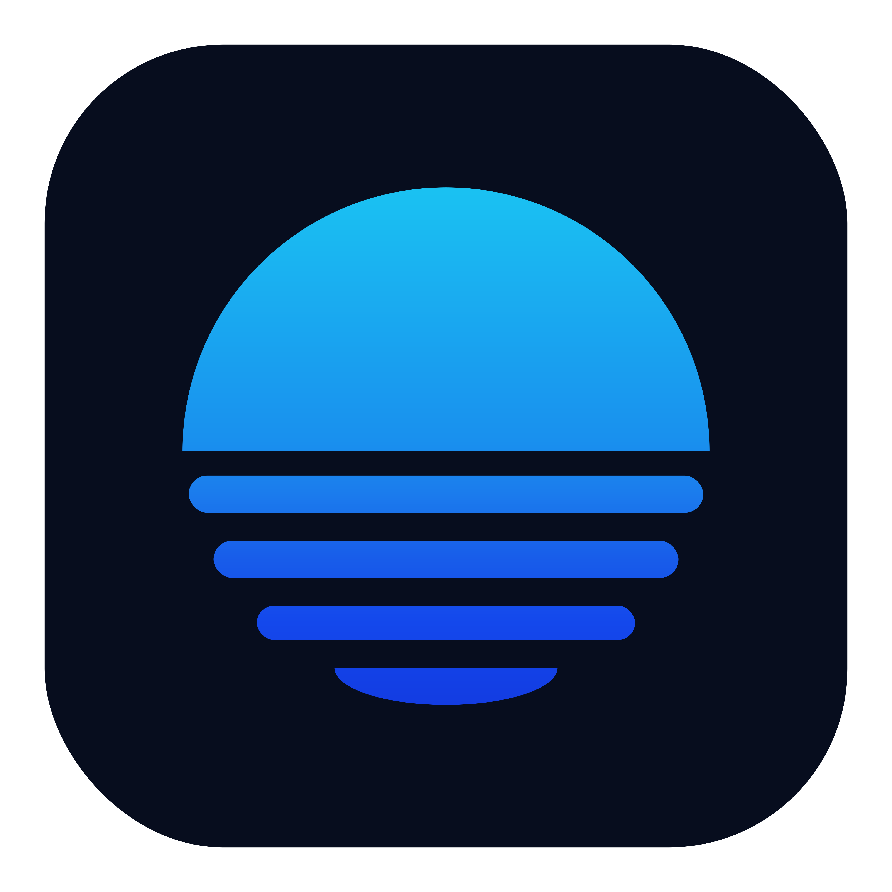
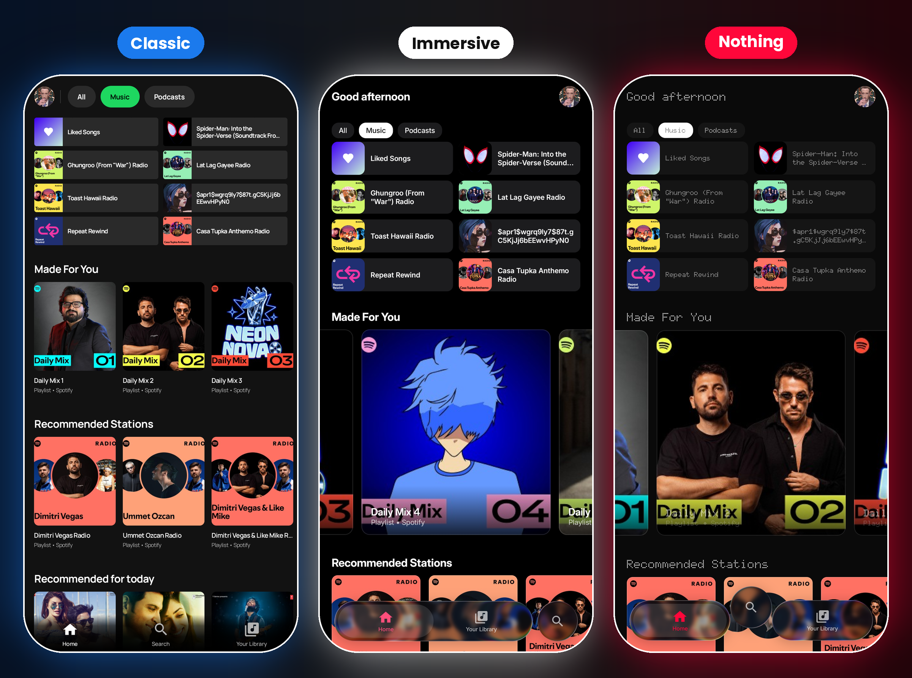

# Encore

**Spotify without ads, on a free account.** Your own Spotify account, playlists and Wrapped, in a native Android app that blocks the ads, with offline downloads through extensions you install.   In 3 new Looks!

  

### 🚫 Spotify with no ads, on a free account
No audio ads, no video ads, no banners, and no 30-second break between songs. Free account plays like Premium: pick any song, skip as much as you want. No Premium, no modified Spotify app, nothing to root.

### ✨ Everything you expect from Spotify, and more
Your home, search, library, playlists, podcasts, Spotify Connect and Android Auto, plus **word-by-word lyrics**, **official music videos** and **song meanings from Genius**.

## What is it?

You sign in with your usual Spotify account, on Spotify's own login page: Encore never sees your password. A free account is enough.

Under the hood, the official Spotify Web Player plays the music, hidden inside the app, with your phone's DRM. Encore draws its own screens on top and drives it. Your plays are reported to Spotify exactly as in a browser: they count for the artists, in your history and in your Wrapped.

## Privacy Focus

**Is it safe for my account?** Myspoti talks to Spotify the way its web player does, and you sign in on Spotify's own page. Blocking ads is still against Spotify's Terms of Use (see the disclaimer below).

**What leaves my phone?** Your plays go to Spotify. Lyrics are looked up on lyrics sites, song meanings on Genius, translations on Google Translate, music videos on YouTube, and downloads on the hosts your download-source extension names (shown before you install it). Nothing is sent to the developer.

## Disclaimer

Blocking ads goes against Spotify's Terms of Use, and Spotify may suspend accounts that do it. Use this app at your own risk.

## For developers

The Android project is in seven Gradle modules:

- **`:api`** is the contract the UI talks to: plain Kotlin models and interfaces (player, search, catalog, library, playlists, home, podcasts, users, lyrics, devices, Jam).
- **`:api-spotify`** implements it on Spotify's Web Player. Playback stays in the official player, in a hidden WebView (`:host-android`), driven by a small bridge script. Catalog, search and library calls go straight to Spotify's servers. When Spotify ships a new Web Player, the app reads its new operation list by itself.
- **`:host-android`** is that WebView, plus the playback service (media session, notification, Android Auto browsing) and the app's Android-only pieces (logbook, covers).
- **`:host-cdp`** runs the same API on desktop Chrome, so the whole API is tested against the real Web Player without a phone.
- **`:extensions`** is the sandbox third-party scripts run in (manifest, permissions, catalogue), plain JVM: an extension runs the same on a desktop. :extensions-cli` is that desktop runner.
- **`:app`** is the Compose UI, in its Classic, Immersive and Nothing looks.

## Credits

- Spotify Wrapper structure : [Myspoti](https://github.com/kota-zo/myspoti) (GPL-3.0) Generic Spotify Web Player enclosed within app framework.
- UI derived from [Spotui](https://github.com/Spotui/Spotui) / [Metrolist](https://github.com/MetrolistGroup/Metrolist) (GPL-3.0); Spotui also gave the DASH-to-FLAC remux.
- The Immersive look (player, lyrics, queue, glass tab bar and pages) is ported from [BitChord](https://github.com/kushagrasinghx/BitChord) (GPL-3.0-or-later).
- [NewPipeExtractor](https://github.com/TeamNewPipe/NewPipeExtractor) (GPL-3.0): music videos.
- Lyrics: [LRCLIB](https://lrclib.net), LyricsPlus, lrc.red, Kugou and NetEase; song meanings: [Genius](https://genius.com).
- [Material Icons](https://github.com/google/material-design-icons) (Apache 2.0) and the [Manrope](https://github.com/googlefonts/manrope) font
- The [Doto](https://github.com/oliverlalan/Doto) dot-matrix font, the typeface of the Nothing look.
